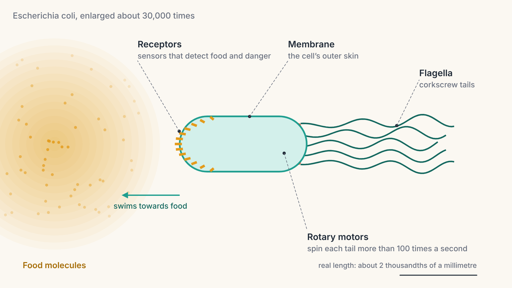
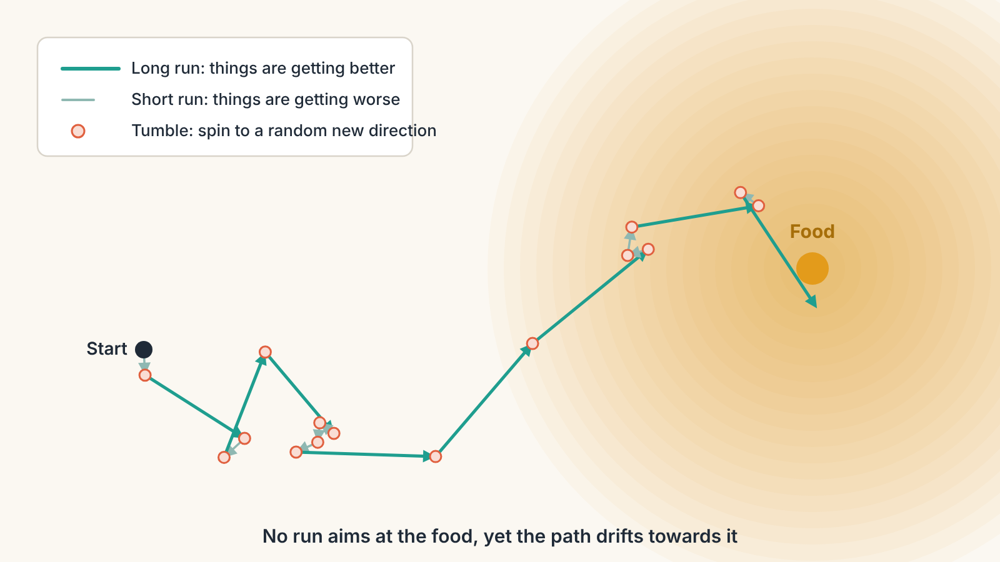
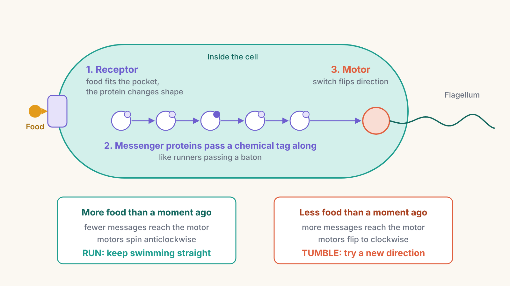
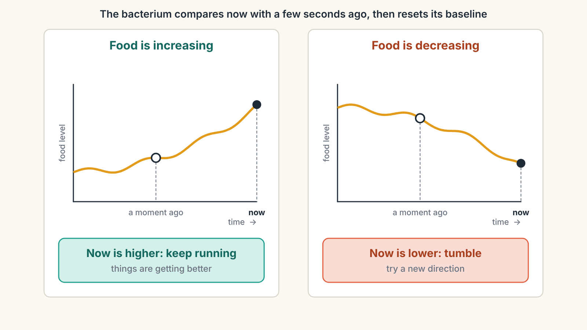
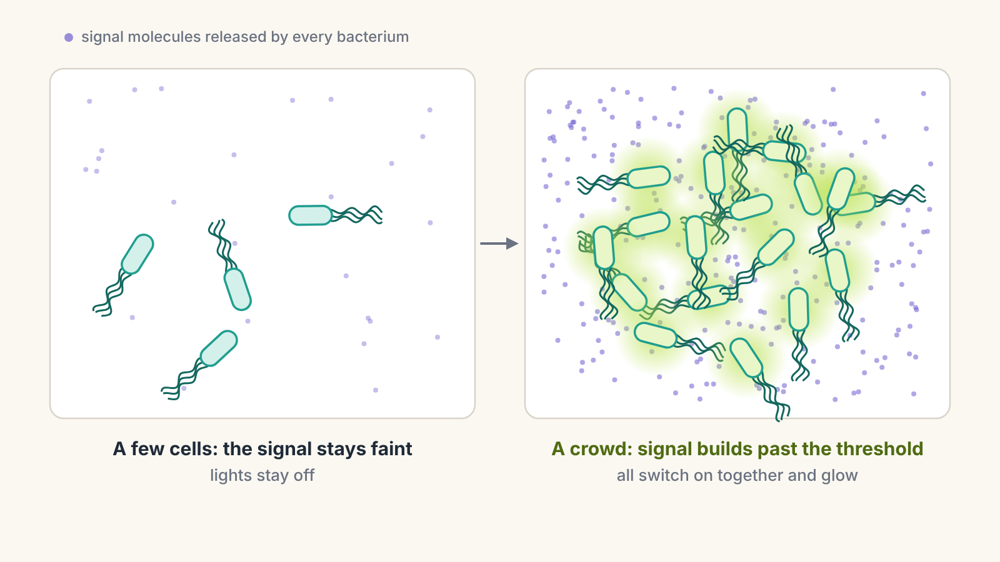

# From Bacteria to Bach, Part 1: The Smallest Decision-Maker

*How a single bacterium finds food with no brain at all*

Put a tiny drop of sugar water into a dish crowded with bacteria, wait a few minutes, and look through a microscope. The bacteria will have gathered around the sugar, as if they knew exactly where it was.

They have no eyes. No nose. No brain. Not even a single nerve cell. Each one is a lone cell, a sealed bag of chemistry far too small to see. And yet it detects food, decides which way to go, and gets there.

This series is about how living things learned to sense the world, respond to it, and eventually get better at it: from a bacterium chasing sugar all the way to a human writing a symphony. Every later chapter builds on the trick you are about to meet. So it is worth understanding properly, because a version of it is still running inside you right now.

---

## Meet the bacterium

> **A note on where life began.** All life on Earth traces back to single cells. The oldest signs of life, from around 3.5 billion years ago, come from tiny single-celled organisms, and for most of Earth's history single cells were the only life there was. Today's bacteria are not those first cells themselves. They are living descendants that kept a similar, very simple design: one cell, with no inner compartments and no organs. That makes a bacterium the simplest living example we have of how life senses and responds to the world, which is why our story starts here.

Our main character is *Escherichia coli*, usually shortened to *E. coli*. Most kinds are harmless, and billions of them live in your gut. One *E. coli* is about two thousandths of a millimetre long. Line them up end to end and roughly 150 would fit across a single grain of table salt.

Life at that size is strange. To a bacterium, water feels thick and sticky, the way honey would feel to you. The physicist Edward Purcell worked out that if a swimming bacterium suddenly stopped pushing, it would glide forward a distance smaller than the width of a single atom before coming to a dead stop. There is no coasting. If it wants to move, it has to keep its engine running every moment.

That engine is remarkable. Sticking out of the bacterium are several long, thin, corkscrew-shaped tails called **flagella** (one is a *flagellum*). At the base of each tail sits a tiny rotary motor, built from proteins, that spins the tail more than a hundred times a second. It is one of the few true spinning wheels found anywhere in nature.

> **New idea: proteins.** Proteins are the working machines of every living cell. They are long chains of building blocks that fold into precise 3D shapes, and their shape decides their job. Some proteins build structures, some speed up chemical reactions, and some, as you will see, act as sensors and switches.

---

## The milestone: run and tumble

Here is the problem the bacterium has to solve. Food is somewhere nearby, dissolved in the water and spreading outwards, so the water closest to the food has the most of it. But the bacterium cannot see where the food is, and it cannot steer like a car. Its tails can only spin one way or the other.

Its solution is called **run and tumble**, and it works like a children's game.

Imagine playing "hot and cold" blindfolded. You cannot see the hidden prize, but a friend calls out "warmer" or "colder" as you move. A sensible strategy goes like this: while you keep hearing "warmer," keep walking straight. The moment you hear "colder," stop, spin around, and set off in a new random direction. You will wander and zigzag, but you will reach the prize surprisingly quickly.

That is almost exactly what *E. coli* does.

- **Run.** When all its motors spin anticlockwise, the corkscrew tails wind together into a single bundle that works like a propeller, and the bacterium swims smoothly forward, usually for about a second.
- **Tumble.** When one or more motors flip to spinning clockwise, the bundle flies apart. For about a tenth of a second the bacterium tumbles on the spot, then sets off in a new, random direction.

The clever part is **when** it chooses to tumble. If things are getting better, with more food than a moment ago, it keeps running for longer. If things are getting worse, it tumbles sooner.

Look at the path in the picture. No single run is aimed at the food. The bacterium has no idea where the food is. But because the good runs last longer and the bad runs get cut short, the whole journey drifts towards the food. Scientists call this a **biased random walk**: random steps, gently nudged in a useful direction.

> **Key idea:** You do not need a map, or even a sense of direction, to find your way. You only need to notice whether things are getting better or worse, and to change what you are doing when they get worse.

---

## How does a cell "sense" anything?

So far we have said the bacterium "notices" more food. But it is a bag of chemicals. How does chemistry notice anything?

The answer is a protein called a **receptor**, built into the cell's outer skin, the membrane. One end of the receptor pokes outside the cell, and the other end sits inside.

Think of a receptor like a doorbell. The outside end has a pocket shaped to fit one particular kind of molecule, such as a sugar, the way only the right key fits a lock. When that molecule drops into the pocket, the whole receptor shifts its shape slightly. Because the receptor passes right through the membrane, that shape change on the outside causes a shape change on the inside. The doorbell has been pressed, and the inside of the cell now "knows" something is out there, even though the sugar never came in.

*E. coli* packs thousands of these receptors into a tight cluster at one end of the cell. They are wired together so that a few receptors detecting something nudge their neighbours too. This amplifies a faint signal into a clear one.

Next, the message has to reach the motors at the other end of the cell. Here the bacterium uses a relay of proteins that pass a small chemical tag from one to the next, a bit like runners passing a baton. The last protein in the relay, the **messenger**, carries the baton to the motor and flips its switch.

The pattern goes like this:

- **Less food than before:** the receptors let the relay run, lots of messengers carry the baton, the motors flip to clockwise, and the bacterium **tumbles**.
- **More food than before:** food in the receptors quiets the relay, fewer messengers reach the motors, they stay anticlockwise, and the bacterium **keeps running**.

> **New idea: signal relay.** Many of the cell's decisions work like this two-part design: a sensor at the surface, and a messenger inside that carries the news to where action is needed. Bacteria use dozens of these sensor-and-messenger pairs, each tuned to something different: salt, oxygen, temperature, acidity. Remember this design. In the next parts of the series, evolution will scale it up dramatically.

---

## The surprising part: a bacterium has memory

There is a puzzle hiding in the hot-and-cold game. "Warmer" only makes sense if you compare **now** with **a moment ago**. That requires memory.

You might expect the bacterium to compare its front end with its back end instead, smelling which side has more food. But it is far too small for that. Across two thousandths of a millimetre, the difference is tiny and gets drowned out by the random jiggling of molecules. So instead of comparing across **space**, the bacterium compares across **time**. It asks: is there more food here than there was a second or two ago?

It keeps this memory using a slow chemical dial on its receptors. Over a few seconds, the cell adds or removes small chemical tags on each receptor, gradually adjusting how sensitive it is to whatever level of food is around. The receptors' current setting is a record of what things were like a few seconds ago. When the food level suddenly rises above that setting, the cell notices. If the level stays the same, the dial catches up and the signal fades away.

You do this too. Walk into a bakery and the smell of fresh bread is overwhelming. Stay ten minutes and you barely notice it, even though the smell is still there. Your nose has reset its dial. Step outside and back in, and the smell hits you again. Scientists call this **adaptation**: a sense that stops responding to what stays the same and responds strongly to what changes.

Adaptation gives the bacterium a superpower. It can track food across an enormous range, from a faint trace to a level roughly 100,000 times stronger, because it is always responding to the **change** rather than the total amount. A sensor that measured only the total would be useless: it would either be flooded at high levels or deaf at low ones.

> **Key idea:** Living sensors mostly detect change, not amounts. They compare the present against a recent baseline, then reset that baseline. This principle, compare and reset, will turn up again and again in this series.

---

## Food or danger?

The same machinery works in reverse. Some receptors are tuned to chemicals that are harmful, such as certain toxic metals. When they detect more of one, the rule flips: things are getting worse, so tumble sooner. The bacterium swims away from danger using exactly the same run-and-tumble trick it uses to swim towards food.

So with a handful of proteins, *E. coli* has a complete behaviour loop:

**Sense** (receptors detect a chemical) → **Decide** (compare with a moment ago) → **Act** (run or tumble).

Every animal that has ever lived, including you, runs some version of this loop.

---

## The limit: a rule that never changes

For all its cleverness, the bacterium has one deep limitation. **Its rule is fixed.**

A bacterium today chases sugar exactly the way its ancestors did hundreds of millions of generations ago. It cannot get better at it through practice. If it swims into the same dead end a thousand times, it does not learn to avoid it. Its few seconds of memory are there to make the comparison work, not to store lessons.

Bacteria do change over very long stretches of time, through evolution: random changes in their genes, with the more successful versions surviving and multiplying. But that is the species changing over many generations, not one bacterium learning during its lifetime. Learning, in the sense of an individual improving through experience, needs a system that can rewrite its own rules. That is still billions of years away.

---

## Bacteria talk to each other

Here is one more surprise that sets up the rest of the series. Bacteria do not only sense food and danger. They also sense **each other**.

Many bacteria constantly release a small signal molecule into the water around them. When only a few are present, the signal stays faint. When a crowd gathers, the signal builds up. Once it passes a threshold, every bacterium's receptors detect it at once, and the whole group switches on new behaviour together. This is called **quorum sensing**, after the "quorum," or minimum number of members a meeting needs before it can make decisions.

A beautiful example lives in the ocean near Hawaii. A small squid called the Hawaiian bobtail squid carries glowing bacteria in a special pouch on its underside. When enough bacteria have gathered there, quorum sensing switches on their light, all at once. The squid uses that glow to match the moonlight from above, hiding its shadow from predators below. A single bacterium glowing would be pointless and wasteful. A crowd glowing together is useful. So they wait until they can sense they are not alone.

---

## Try it yourself: the Run-and-Tumble Simulator

Reading about run and tumble is one thing. Watching it work is better.

<iframe src="run-and-tumble-simulator.html" title="Run-and-Tumble Simulator" width="100%" height="900" style="border:0;"></iframe>

*If the simulator does not appear above, [open the Run-and-Tumble Simulator in its own page](run-and-tumble-simulator.html).*

The simulator has two modes.

**Watch it swim** shows a petri dish from above, with food on one side and a bacterium following the same rule you just read about. Notice that it never stops once it arrives. Like a real bacterium, it keeps running and tumbling, drifting out and back, but the rule keeps pulling it in. Three experiments are worth trying:

1. **Switch to a crowd of 30.** Each one zigzags on its own, yet within about a minute almost the whole group has gathered around the food.
2. **Turn memory down to "none."** Without a way to compare now with a moment ago, the bacterium cannot tell better from worse, and the crowd stays scattered. Then try the other extreme, four seconds: the bacteria react too late, overshoot, and gather much more slowly. Real bacteria compare over about the last second or two.
3. **Add poison** between the bacteria and the food. The same rule, used in reverse, steers them around it.

**Be the bacterium** hides the dish. All you get is what a real bacterium gets: the food level where you are, and whether it is higher or lower than before your last move. You have two buttons, Run and Tumble. Most people are surprised how quickly they find the food with nothing but "warmer" and "colder" to go on.

---

## Where this shows up in your life

This series will keep returning to two everyday examples: training your body, such as learning to run well, and training your mind, such as learning French. For now, just notice the first traces of the bacterium in each.

**In running:** the first few minutes of a run feel loud, with your breathing, heartbeat and footsteps. Ten minutes later you barely notice them. Your senses have adapted, just like the bacterium's receptors. What grabs your attention again is a change, like a sudden hill.

**In French:** as a beginner in a French café, the chatter around you blends into noise, until a word you learned yesterday jumps out from across the room. Your brain, like a bacterium, responds most to what has just changed.

Both examples will grow as the series builds. Once nerves, brains and learning are on the table, we will be able to explain what is really happening when you get better at either one.

---

## Mastery and belonging: where the journey begins

This series is about two great human drives: the drive to **get better at things** (mastery) and the drive to **matter to other people** (belonging). The bacterium shows us the seed of both.

**The seed of mastery is the feedback loop.** Try something, sense whether it made things better or worse, adjust. Every skill you will ever learn, from a tennis serve to a French accent to a piano fugue, grows from this loop. What the bacterium lacks is the ability to keep the lessons. Its loop steers it in the moment, but it never upgrades itself. Real mastery needs a loop that leaves a mark, so each attempt makes the next one better.

**The seed of belonging is the signal from others.** Through quorum sensing, even bacteria change their behaviour when they sense they are part of a group. They hold back from acting alone and act together when the crowd is there. It is a long way from a glowing squid pouch to the pull of friendship or teamwork. But the basic idea was already there 3.5 billion years ago: living things are built to sense each other, and to act differently together than alone.

---

## Key ideas from Part 1

- **Receptors** are protein sensors in the cell's outer skin. When the right molecule fits, they change shape and pass the news inside, like a doorbell.
- A **signal relay** of proteins carries that news from the surface to the motors.
- **Run and tumble:** swim straight while things improve, tumble to a random new direction when they get worse. Random steps, gently biased, lead to food.
- Bacteria compare **now with a moment ago**, using a few seconds of chemical memory.
- **Adaptation:** senses respond to change, then reset to the new normal.
- The bacterium's rule is **fixed**: it steers but never learns.
- **Quorum sensing:** bacteria sense how many others are around and act together.

---

## Coming next

The bacterium has one big limitation we have not mentioned yet: it is alone in its own skin. Every decision happens inside a single cell, where the sensor and the motor are only a few thousandths of a millimetre apart.

About 700 million years ago, the first animals appeared: many cells living together as one body. Suddenly, the cell that sensed danger was no longer the cell that had to move. Chemical messages, which work beautifully across one tiny cell, became far too slow across a whole body.

In [**Part 2: A Body Without a Boss**](part-2-a-body-without-a-boss.md), we will see how cells first learned to talk to each other, how the first nerve cells and electrical signals appeared, and how a jellyfish coordinates its entire pulsing body without any brain in charge.
