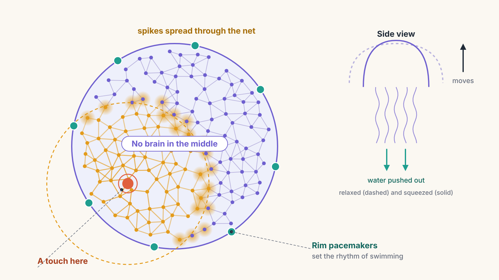
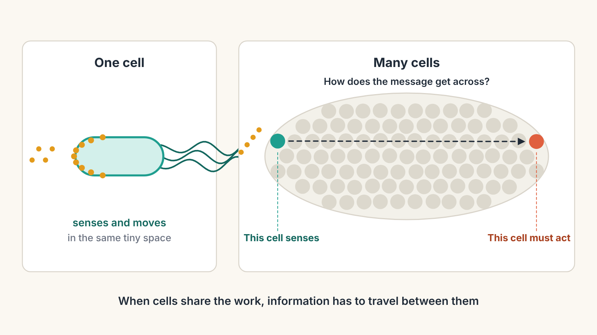
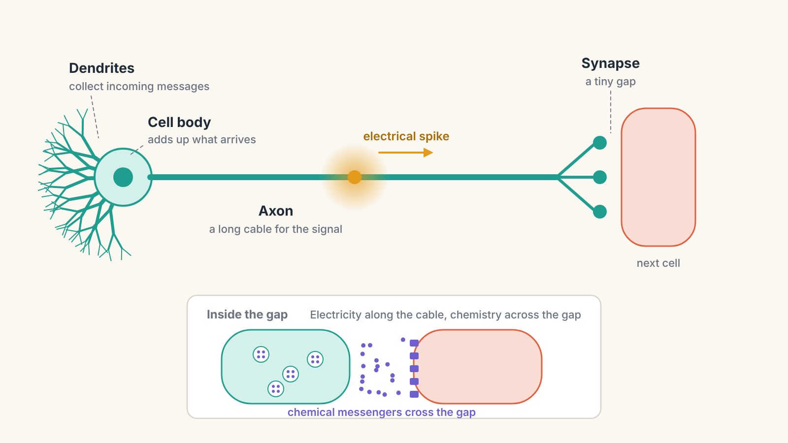
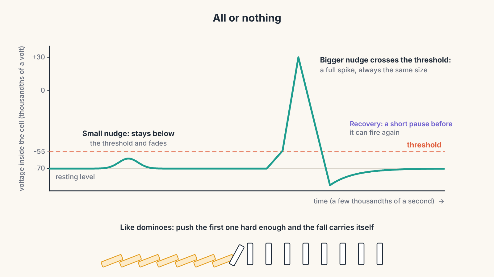

# From Bacteria to Bach, Part 2: A Body Without a Boss

*How cells learned to talk, and how a jellyfish moves its whole body with no brain in charge*

In Part 1 we met the bacterium: a single cell that senses food, compares now with a moment ago, and decides whether to keep swimming or tumble. Everything happened inside one tiny bag of chemistry. The sensor at one end and the motor at the other were only a few thousandths of a millimetre apart, so a message could get from one to the other almost instantly.

For billions of years, that was enough. Then life tried something new: cells started living together as a single body. That one change created a problem the bacterium never had, and solving it led, step by step, to the first nerve cells.

This part of the series covers three big ideas: why cells joined up, how they first talked to each other, and how the first nerves turned a crowd of cells into a body that moves as one.

---

## Why live together?

Roughly 700 million years ago, the first animals appeared. Instead of one cell doing everything, an animal is many cells that stick together and share the work.

Think of the difference between one person running a tiny shop alone and a big restaurant. The shop owner does everything: buys the food, cooks, serves, cleans. A restaurant has a team, where some people cook, some serve, and some wash up. Each person gets very good at one job, and together they can do far more than anyone alone.

Cells in a body do the same. Some cells sense the world. Some cells move. Some digest food. Each one specialises. This sharing of jobs is one of the most powerful tricks in the history of life.

But a team has a problem a lone worker never has: **communication**. A waiter who takes an order has to get it to the kitchen. And in a body, the cell that senses danger is usually **not** the cell that needs to move.

> **Key idea:** Once cells split up the jobs, information has to travel between them. The story of nerves and brains is the story of solving that problem better and better.

---

## The first conversations: chemical messages

The first way cells talked to each other used the same tool the bacterium already had: **receptors**, the "doorbell" proteins from Part 1.

One cell releases a small chemical messenger into the space around it. The messenger drifts outwards. When it reaches a neighbouring cell with the right receptor, it presses the doorbell, and that cell responds. It is the same lock-and-key system the bacterium used to sense sugar, except now the "key" is a message sent by another cell.

Sponges still live this way. They are some of the simplest animals alive today, and many scientists think they belong to one of the oldest animal groups. A sponge has no nerves and no muscles, yet its cells coordinate. When a freshwater sponge gets clogged with sediment, it slowly squeezes its whole body to flush water out, a kind of slow-motion sneeze. But it takes around half an hour or more to complete, because the message travels from cell to cell by chemical drift.

Here is a surprise: sponges already carry many of the genes for the proteins that nerve connections in your brain use today. The parts list for nerves was being assembled before nerves themselves appeared, like a toolbox waiting for someone to build with it.

---

## The problem with drifting chemicals

Chemical messages work beautifully over tiny distances. Over larger ones they become painfully slow, and the reason is worth understanding.

A chemical messenger does not travel in a straight line. It gets knocked about by water molecules, zigzagging randomly, like a person trying to cross a packed crowd by being shoved this way and that. This random spreading is called **diffusion**. You can watch it by dropping ink into a glass of still water: it spreads quickly at first, then slows to a crawl.

Diffusion has a nasty rule. **If you double the distance, the time it takes goes up four times.** Ten times the distance takes a hundred times longer. Scientists say the time grows with the square of the distance.

For a typical small messenger molecule in water, rough figures look like this:

- Across one cell (a hundredth of a millimetre): about **a twentieth of a second**.
- Across one millimetre: about **eight minutes**.
- Across one centimetre: **more than half a day**.

A bacterium-sized creature can live with diffusion. An animal the size of your finger cannot. If you had to wait half a day for a "danger!" message to cross your hand, you would be eaten long before you moved. Bigger, moving animals needed a completely different kind of message.

> **Key idea:** Chemical drift is fine inside a cell and hopeless across a body. Getting bigger forced life to invent faster wires.

---

## The invention: the neuron

The answer was a new kind of cell: the **neuron**, or nerve cell.

A neuron is a cell stretched out to carry messages. It has three main parts:

- **Dendrites**: short branches that collect incoming messages, like a set of ears.
- **The cell body**: the main part of the cell, which adds up what the dendrites hear.
- **The axon**: a long, thin fibre that carries the neuron's own message onwards, like a cable. In your body, a single axon can run from your lower back all the way to your toes.

The big change is what travels along the axon. It is not a drifting chemical. It is an **electrical signal**.

---

## How can a cell make electricity?

This sounds strange, but every cell in your body is a tiny battery. Here is how.

Water inside and outside cells is full of **ions**: atoms or small molecules that carry an electric charge, such as sodium and potassium. A cell's membrane keeps them unevenly sorted, with more sodium outside and more potassium inside. Tiny protein pumps in the membrane work constantly to keep it that way. Because the charges are uneven across the membrane, the inside of a resting neuron sits at a small negative voltage compared to the outside, about seventy thousandths of a volt. That is roughly a twentieth of a standard AA battery, but across a membrane far thinner than a soap bubble.

The membrane is also dotted with **ion channels**: protein gates that can snap open and let ions rush through.

> **New idea: ion channels.** These are tiny doors in the cell membrane that open and close in response to voltage or chemicals. When a door opens, charged particles flood through, and the cell's voltage changes in a fraction of a millisecond. Ion channels are much older than nerves. Bacteria have them, and single-celled creatures like the slipper-shaped *Paramecium* already fire electrical spikes. When a *Paramecium* bumps into something, a spike reverses the beating of its tiny hairs and it backs away. Neurons took this old trick and put it on a long cable.

Now picture what happens when a neuron is triggered.

1. A message arrives and nudges the voltage at one spot a little less negative.
2. If the nudge is too small, nothing much happens, and the voltage settles back.
3. But if it crosses a certain level, called the **threshold**, sodium gates at that spot snap open. Sodium floods in, and the inside of the cell briefly turns positive.
4. That sudden change opens the sodium gates next door, which open the gates next to them, and so on down the axon.

This travelling pulse is called an **action potential**, or a spike.

The best analogy is a line of dominoes, or a fuse burning along a firework. You do not have to push every domino. You push the first one hard enough, and the fall carries itself all the way to the end. And just like a domino, a spike has two important properties:

- **All or nothing.** A push below the threshold does nothing. A push above it produces a full spike, always the same size. A neuron cannot send half a spike. It signals strength in other ways, such as by firing faster.
- **One way only.** Right after a stretch of membrane fires, it needs a moment to reset, like a fallen domino that has to be stood back up. This recovery time stops the spike from running backwards, so it always travels forward.

How fast is it? In a jellyfish, nerve signals often travel at less than a metre per second, slower than you walk. That sounds slow, but compare it with diffusion. A signal that crosses one centimetre in about a fiftieth of a second is more than **two million times faster** than a chemical drifting the same distance.

---

## Crossing the gap: the synapse

When the spike reaches the end of the axon, it meets a tiny gap between this neuron and the next cell. This gap is called a **synapse**.

Electricity cannot jump this gap directly at most synapses. Instead, the arriving spike makes the axon end release a puff of chemical messengers called **neurotransmitters**. They drift across the gap, which is so narrow that diffusion takes a tiny fraction of a millisecond, and press receptors on the next cell. If enough receptors are pressed, the next cell may fire its own spike.

Notice what has happened. The old chemical doorbell from Part 1 has not been thrown away. It has been kept for the one place where it works well: a very short hop. The long distance is now covered by electricity.

There is a deeper reason the gap matters, and it will become the heart of this whole series. The synapse is a **control point**. How strongly one neuron affects the next can be turned up or turned down. In later parts we will see that learning, from a sea slug remembering a shock to you learning a French word, is mostly a matter of adjusting these gaps.

> **Key idea:** Neurons send messages two ways. Electrical spikes race along the cable, and chemical messengers cross the tiny gap at the end. The gap is adjustable, and that adjustability is where learning will come from.

---

## The first nervous system: the jellyfish

Now we can build a body that moves as one. Enter the jellyfish.

A jellyfish swims by squeezing its bell-shaped body, pushing water out behind it, then relaxing and refilling. For that squeeze to work, muscle cells all around the bell need to contract at nearly the same moment. A squeeze on only one side would just make it wobble.

The jellyfish solves this with a **nerve net**: neurons spread across the bell in a loose web, each one connected to its neighbours. There is no brain and no central control. When one part of the net fires, its spikes pass to the neighbours, which pass them on, and the signal ripples outwards across the whole bell in a fraction of a second. The muscles contract together, and the jellyfish pulses forward.

Think of a stadium wave, with thousands of people standing and sitting in a rolling wave around a stadium. Nobody conducts it. Each person simply reacts to their neighbours. The pattern emerges from the crowd.

The nerve net has some remarkable strengths:

- **No single point of failure.** Cut a piece of the net, and signals simply route around the damage, because there are many paths. A jellyfish can lose part of its bell and still swim.
- **Touch anywhere, respond everywhere.** A touch on any part of the bell can trigger the whole body to react.

Jellyfish are not completely without structure. Many have small clusters of sensory cells around the rim of the bell. These act as **pacemakers**, firing on a rhythm to set the beat of swimming, and some sense light and gravity so the jellyfish knows which way is up. But there is still no boss in the middle making decisions.

> **New idea: pacemaker.** A pacemaker is a group of cells that fire on their own, in a steady rhythm, and set the timing for everything connected to them. You have one too: a small patch of cells in your heart that starts every heartbeat.

---

## The limit: everything goes everywhere

The nerve net is brilliant for one job: making the whole body do one simple thing together. But it has a serious weakness. When a signal spreads to everyone, it is hard to do anything **precise**.

A jellyfish cannot easily coordinate a complex sequence, like "turn left, then grab with this one tentacle, then flee." Its body is also round, with no front and no back. It drifts and pulses, meeting the world from every direction at once, so there is no obvious place to put the most important sensors, or a control centre.

That limit sets up the next big step in evolution. Animals that started moving in one direction, head first, would need their nerves to do something new: gather together, and take charge.

Scientists are still debating some of the details of this early history, including whether nerve cells evolved once or more than once in the earliest animals. But the overall pattern is clear: chemical messages first, then electrical nerves, then nets, then centres.

---

## Try it yourself: the Nerve Net Simulator

<iframe src="nerve-net-simulator.html" title="Nerve Net Simulator" width="100%" height="900" style="border:0;"></iframe>

*If the simulator does not appear above, [open the Nerve Net Simulator in its own page](nerve-net-simulator.html).*

The simulator shows a jellyfish bell from above, with its web of nerve cells. Tap anywhere on the bell to stimulate the neuron there, and watch the spike spread through the net. When enough neurons fire, the bell contracts.

Four experiments are worth trying:

1. **Turn the touch strength down below the threshold.** The neuron twitches, but nothing spreads. Turn it up past the threshold and the whole net fires. All or nothing.
2. **Switch the message type from "nerve" to "chemical."** The same touch now spreads by slow drift, and the bell crumples unevenly instead of pulsing as one.
3. **Make a small cut in the net,** then tap. The signal flows around the damage. Then cut the bell right across the middle and tap one side: only that half contracts.
4. **Turn on the rim pacemakers** and watch the jellyfish beat on its own, with no touch at all.

---

## Where this shows up in your life

These two everyday threads, training your body and training your mind, will keep growing through the series. Here is what Part 2 adds.

**In running:** your heart works much like a jellyfish bell. A small pacemaker patch fires on its own, and the electrical wave spreads from cell to cell across the heart muscle, so it squeezes as one. That is why a heart keeps beating even after a transplant, when its nerve connections to the brain have been cut. Your brain can speed it up or slow it down when you run, but it does not have to start every beat. Your gut has a net-like nervous system too, with hundreds of millions of neurons running the waves of digestion largely on their own.

**In learning French:** every sound you hear, every *bonjour* and every rolled *r*, reaches your brain the same way: as trains of all-or-nothing spikes travelling along nerve fibres. Your ears do not send sound to the brain. They send spikes. And when you finally remember a new word, it will be because some synapses, those adjustable gaps, have changed. We will see exactly how in Part 4.

---

## Mastery and belonging: the team and the gap

**Belonging starts with cooperation.** A multicellular body is a group of cells that gave up living alone in exchange for being part of something bigger. Each cell does one job, trusts the others to do theirs, and listens to its neighbours. Without that cooperation, a body could not exist. When a cell stops listening to its neighbours and starts multiplying for itself alone, the result is disease. Being part of a team, and keeping in touch with it, was built into animal life from the very beginning.

**Mastery starts with the gap.** The synapse, that tiny adjustable gap between neurons, is the seed of every skill you will ever learn. A connection that can be made stronger or weaker is a connection that can change with experience. The jellyfish barely uses this ability. But it is there, waiting, in the very first nervous systems.

---

## Key ideas from Part 2

- About 700 million years ago, cells joined into the first **animals** and began to **specialise**, sharing out the jobs.
- Specialising created a new problem: the cell that senses is often not the cell that acts.
- The first solution was **chemical messages** between cells, using receptors. Sponges still work this way.
- **Diffusion** is fast over tiny distances but hopeless over large ones: double the distance, four times the time.
- The **neuron** carries messages as electrical spikes along a long fibre called the **axon**.
- Cells are tiny batteries. **Ion channels** open to create an **action potential**: a self-renewing spike that is all or nothing and travels one way.
- At the **synapse**, the electrical spike is turned into a chemical message for a short hop. The synapse is adjustable, which will matter enormously for learning.
- Jellyfish use a **nerve net** with no central brain. It is robust and coordinates simple whole-body movement, but cannot do complex, precise actions.

---

## Coming next

A jellyfish meets the world from every direction at once. But some early animals began moving in one direction, always head first. That simple change meant the front end met everything first: food, danger, light, smells.

In [**Part 3: Heading Somewhere**](part-3-heading-somewhere.md), we will see how moving forward pulled the senses to the front, how nerves gathered into a cord and then a brain, how insulated nerve fibres made signals dramatically faster, and how a second, slower messaging system, hormones, began to tune the whole body.
