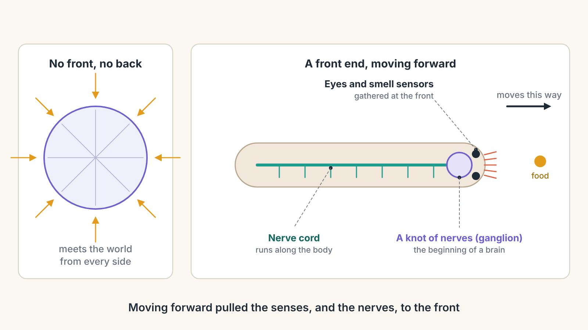
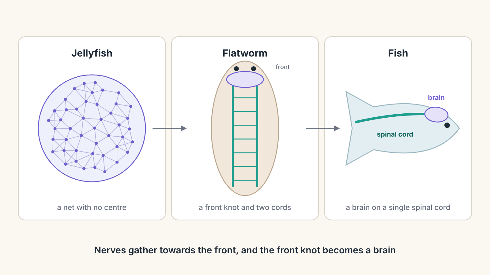
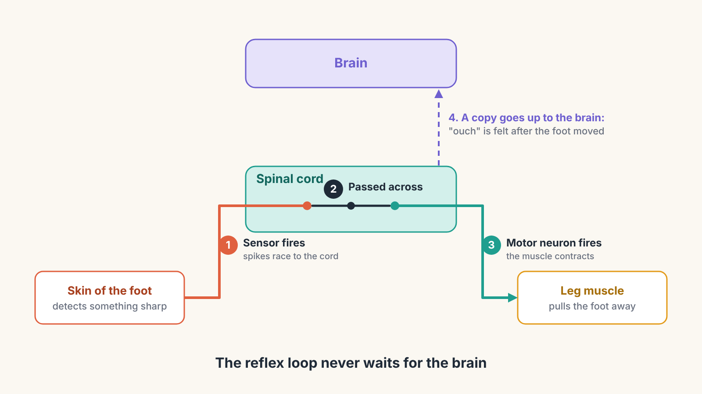
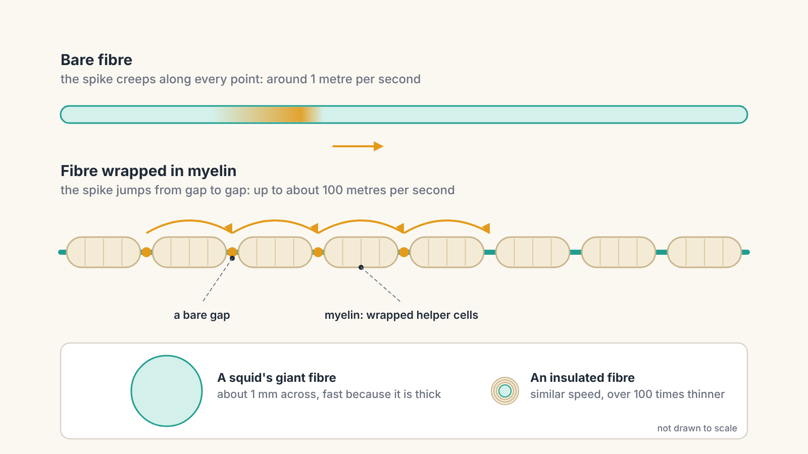
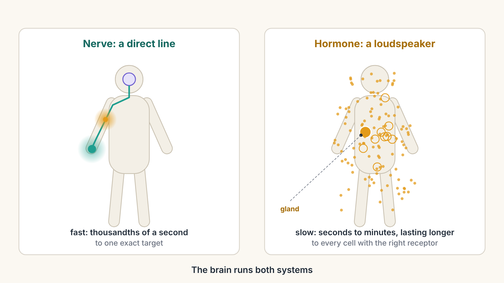

# From Bacteria to Bach, Part 3: Heading Somewhere

*Why moving forward gave animals a head, and the head a brain*

In Part 2 we met the jellyfish. Its nerve net spreads a signal across the whole bell, so all its muscles squeeze together and it pulses through the water. There is no boss in the middle. Every neuron only talks to its neighbours.

That works well for an animal that drifts and meets the world from every direction at once. But some early animals did something different. They started moving in one direction, always the same end first. That small change in lifestyle reshaped the whole nervous system. It pulled the senses to the front, gathered the nerves into a cord, and grew a brain at the front of that cord.

This part covers four big ideas: why moving forward created a head, how nerves gathered into a spinal cord and a brain, how insulation made nerve signals dramatically faster, and how a second, slower messaging system, hormones, came to tune the whole body.

---

## The milestone: a front end

A jellyfish is round. Turn it any way you like and it looks the same. Scientists call this **radial symmetry**, like a pizza or a wheel.

More than 550 million years ago, animals appeared with a different body plan: a front and a back, a left side and a right side that mirror each other, a top and a bottom. This is called **bilateral symmetry**, and you have it. Draw a line from the top of your head down to your feet, and your left half roughly mirrors your right.

A body with a front can do something a jellyfish cannot: travel steadily in one direction. And once an animal moves forward, its front end becomes special. It is the part that arrives first. It meets food first, bumps into danger first, and enters new light, new smells and new temperatures first.

So evolution moved the senses there. Eyes, smell detectors and touch sensors became concentrated at the front, the way a car has its headlights, sensors and driver at the front, not scattered randomly around the back. This gathering of senses at the front is called **cephalization**, from the Greek word for head. It is, quite literally, the invention of the head.

> **Key idea:** Moving forward made the front end the most important place on the body. Senses gathered there, and so did the nerves that process what the senses report.

---

## From a net to a cord to a brain

Once the senses sat at the front, it made sense for nerve cells to gather nearby. Short wires are fast wires. If the cells that process smell sit right next to the nose, the message does not have to travel far.

You can see this gathering in living animals today, like a series of snapshots.

- A **jellyfish** has a spread-out net with no centre.
- A **flatworm**, a small worm-like animal that glides along pond bottoms, has a small knot of nerve cells at its front end and two nerve cords running down its body, connected like the rungs of a ladder.
- Our own distant ancestors, small swimming animals shaped a bit like a sleek eel, had a single **nerve cord** running along their back, with a slightly swollen front end.

> **New idea: ganglion.** A ganglion is a knot of nerve cells packed together, where many signals meet and get combined. A brain began as a large ganglion at the front of the body.

Why does gathering nerves together matter so much? In a net, every neuron only hears its neighbours. In a knot, thousands of neurons can talk to each other at once, mixing information from different senses. A cluster can **combine and compare**: "I smell food ahead, but I also see a large shadow." That ability to weigh things up, instead of just passing a signal along, is the beginning of making decisions.

A useful way to picture it: a crowd passing a rumour from person to person versus a control room where all the reports arrive in one place and someone can look at the whole picture.

---

## The spinal cord: more than a cable

Fish, frogs, birds and you all inherited that nerve cord along the back. In you, it is the **spinal cord**, a bundle of nerve tissue about as thick as your finger, running down inside your spine. The bones of the spine are its armour.

It is tempting to think of the spinal cord as just a cable carrying messages between the brain and the body. It is that, but it does far more. It has two jobs that matter for everything else in this series.

### Job one: reflexes

Touch something hot, and your hand jerks away **before** you feel any pain. That happens because the message never has to reach your brain first.

Here is the route:

1. Sensors in your skin detect the heat and send spikes up a nerve to the spinal cord.
2. Inside the cord, the signal is handed across a synapse or two to a **motor neuron**, a nerve cell that controls a muscle.
3. The motor neuron fires, and your arm muscle pulls your hand away.

At the same time, another copy of the message travels up to the brain. By the time it arrives and you think "ouch," your hand is already moving. This short loop is called a **reflex arc**. The famous knee-jerk at the doctor's is an even simpler version, where a single sensory neuron connects directly to a single motor neuron.

Why have reflexes at all? Because the brain is far away, and thinking takes time. For dangers that need the same response every time, it is faster to handle them locally.

### Job two: rhythm

The spinal cord also contains small circuits that can produce rhythmic movement on their own: left, right, left, right. Scientists call them **central pattern generators**. In classic experiments, cats whose spinal cords had been disconnected from the brain could still make stepping movements on a moving treadmill, and even adjusted their stepping to its speed.

This means the brain does not command each step. It acts more like a manager, saying "walk, this fast, this way," while the spinal cord handles the left-right rhythm. This idea will come back when we talk about running.

---

## The brain grows from the front of the cord

In every vertebrate embryo, including you before you were born, the nervous system starts as a simple tube. The back part stays a tube and becomes the spinal cord. The front end swells into a series of bulges, and those bulges become the brain. The brain is, in a real sense, the front end of the nerve cord that kept growing, because the front is where the senses are.

The brain did not grow all at once. It grew in **layers**, with newer parts built on top of older ones.

- The **brainstem**, at the bottom where the brain meets the spinal cord, runs the basics without you thinking: breathing, heartbeat, swallowing, staying awake.
- The **cerebellum**, a wrinkled lump at the back, specialises in balance and precise timing. It compares the movement you intended with the one that happened and corrects the difference.
- The **forebrain**, on top, handles senses, memory and choosing what to do. In mammals, and above all in humans, its outer layer grew enormously. That story belongs to Parts 4 and 5.

A good way to picture this layering is a company. Workers on the floor handle routine jobs quickly. Supervisors coordinate them. Managers at the top set goals and handle unusual situations. Most of the time, the managers let the lower levels get on with it, and step in only when something new or tricky comes up. Your brain works the same way: old, fast, automatic control at the bottom, newer, slower, flexible control on top.

---

## The speed upgrade: insulation

As animals grew bigger, they hit a new problem: distance again. A nerve signal in a jellyfish travels at less than a metre per second. That is fine across a small bell. But imagine a fish two metres long, or a giraffe whose brain is several metres from its feet. At walking pace, a "danger at the tail" message would arrive far too late.

Evolution found two solutions.

The first was **thicker cables**. A thicker axon conducts faster, the way a wide pipe carries water more easily than a narrow one. The squid took this to an extreme: its escape system uses giant axons up to about a millimetre across, about as wide as a pencil lead. They are fast, but enormous. A body built only from giant wires would have no room for anything else.

The second solution, which appeared in early jawed fish over 400 million years ago, was far more elegant: **insulation**.

Special helper cells wrap themselves around an axon many times, like tape wound around a wire. This fatty wrapping is called **myelin**. It is not continuous. There are tiny bare gaps between the wrapped sections. Because the wrapping keeps the electrical signal from leaking out, the spike does not need to be rebuilt at every point along the axon. Instead, it jumps from gap to gap.

Think of crossing a river on stepping stones instead of wading. Or an express train that only stops at a few stations instead of every one.

The result is dramatic. A bare nerve fibre might carry a signal at around one metre per second. A thin, well-insulated fibre in your body can carry it at up to around 100 metres per second, faster than a high-speed train, while staying far thinner than a squid's giant axon. Myelin is also why your brain contains "white matter": the insulation is pale and fatty, and great bundles of insulated fibres look white.

> **Key idea:** Myelin made nerves fast without making them fat. It is one of the reasons large, quick, complex animals became possible. And as we will see later in the series, your brain keeps adding myelin around circuits you use a lot.

---

## The second messaging system: hormones

Nerves are fast and targeted, like a phone call to one person. But sometimes the body needs something different: a message to **everyone at once**, which lasts for a while.

That is the job of **hormones**. A hormone is a chemical messenger released by a **gland** into the bloodstream. The blood carries it everywhere, and every cell with the right receptor responds. Blood takes about a minute to circulate around the whole body, and hormone effects can last from minutes to hours or longer.

If nerves are text messages to one person, hormones are an announcement over a building's loudspeaker: slower, less precise, but heard everywhere. Some examples you have felt yourself:

- **Adrenaline**, from glands on top of your kidneys, prepares the whole body for action: faster heartbeat, more sugar in the blood, wide-open airways. It is the "all hands on deck" alarm.
- **Cortisol**, from the same glands, helps the body handle longer-lasting stress and is part of your daily wake-up rhythm.
- **Melatonin** rises in the evening and helps signal that it is time to sleep.

Hormones are older than vertebrates. Insects, for example, use them to control when they shed their skin. But vertebrates organised their hormones under a central command: a tiny gland at the base of the brain called the **pituitary**, which in turn takes orders from a part of the brain just above it. This means the brain can run both systems: fast, precise nerves and slow, body-wide hormones.

There is one more kind of broadcast that lives inside the brain itself, using chemicals such as dopamine to tell many connections at once that something matters. That turns out to be the key to learning, and it is the heart of Part 4.

---

## Try it yourself: the Signal Race

<iframe src="signal-race-simulator.html" title="Signal Race" width="100%" height="950" style="border:0;"></iframe>

*If the simulator does not appear above, [open the Signal Race in its own page](signal-race-simulator.html).*

You step on something sharp. How quickly does your foot pull away? The simulator lets you race the message along different routes and compare the times.

Try these:

1. **Reflex versus thinking it over.** Send the message as a spinal reflex, then route it through the brain for a decision. The brain route takes several times longer, mostly because deciding takes time.
2. **Switch off the insulation.** Remove myelin and race again. The same reflex goes from a few hundredths of a second to a couple of seconds.
3. **Change the body size.** Compare a mouse, a human and a giraffe, with and without myelin. The bigger the body, the more insulation matters.
4. **Send it by hormone.** Watch how long a message through the blood would take. Hormones are good for many things, but not for getting out of danger.

---

## Where this shows up in your life

**In running:** you have probably caught yourself after a trip or a stumble before you even knew it had happened. That was your spinal cord and brainstem, responding faster than thought. Your running stride itself leans on the spinal rhythm circuits: your brain decides "run, at this pace," and the cord handles much of the left-right pattern. Before a race, the nervous excitement you feel is partly adrenaline, the body-wide loudspeaker telling every cell to get ready.

**In learning French:** speaking a new language is partly a movement skill. Saying the French *r* or rounding your lips for the *u* in *tu* needs precise timing of dozens of tiny muscles in your throat, tongue and lips, and that timing is the speciality of the cerebellum. Every new sound you practise is fine-tuned there. And the insulation story will matter too: circuits you use often get wrapped in more myelin over time. We will come back to that when we reach mastery.

---

## Mastery and belonging: headquarters and the loudspeaker

**Mastery begins with layers.** A layered nervous system can hand routine jobs down to faster, lower levels, like reflexes and rhythms, and free the upper levels for what is new or difficult. That handing-down is exactly what happens when a skill becomes automatic: something that once took careful thought becomes something the lower layers just do. And myelin, the insulation that made big animals possible, is laid down more thickly around circuits that get used a lot. Practice literally builds faster wiring.

**Belonging gets a broadcast system.** Hormones are the body's way of putting every cell in the same mood at the same time, whether alert, calm, or ready to sleep. And animals with a head and forward-facing senses gained something else: the ability to watch each other. Think of a school of fish turning together in an instant. There is no leader. Each fish watches its nearest neighbours with its eyes and feels their movement in the water through a line of sensors along its sides, and keeps its place. It is the jellyfish's stadium wave again, but now between whole animals. Sensing others, and moving with them, becomes one of the most powerful things a nervous system can do.

---

## Key ideas from Part 3

- More than 550 million years ago, animals with **bilateral symmetry** appeared: a front and a back, a left and a right.
- Moving forward made the front end meet the world first, so senses gathered there. This is **cephalization**, the invention of the head.
- Nerves gathered too: from a net, to a **ganglion** and ladder-like cords, to a single **nerve cord** with a brain at its front.
- The **spinal cord** is more than a cable. It runs **reflexes** that act before the brain knows, and **rhythm circuits** that generate stepping.
- The brain grew in **layers**: the brainstem for life support, the cerebellum for balance and timing, the forebrain for senses, memory and choices. Older layers are fast and automatic; newer ones are slower and flexible.
- **Myelin** insulation lets signals jump between gaps, making nerves up to about a hundred times faster without making them thick.
- **Hormones** are a second, slower messaging system: glands release them into the blood, and they set the state of the whole body.

---

## Coming next

So far, our animals sense, react and coordinate, faster and faster. But they mostly do the same thing every time. A reflex that pulls your foot from a thorn today will do exactly the same tomorrow.

In [**Part 4: Wired to Belong**](part-4-wired-to-belong.md), the nervous system learns to change itself. We will see how the brain decides which experiences are worth remembering, why the chemical dopamine is really a surprise signal, how curiosity and play turn learning into something animals seek out, and why, for social mammals like us, being left out can hurt in a way that is surprisingly close to physical pain.
