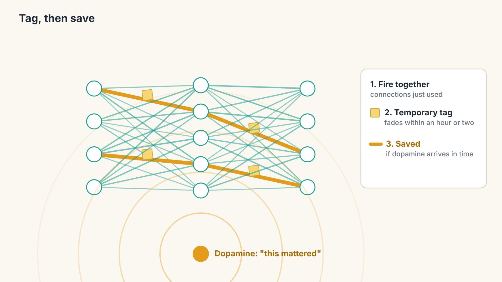
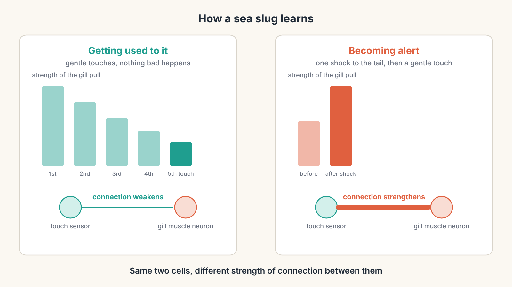
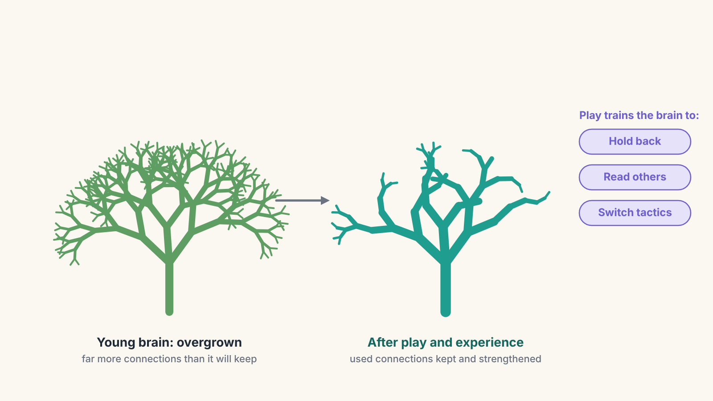
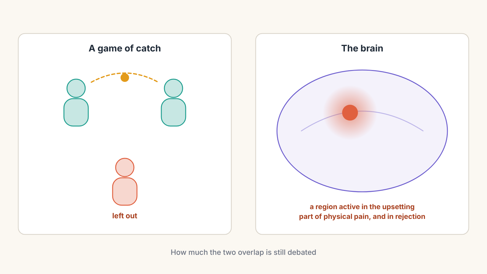

# From Bacteria to Bach, Part 4: Wired to Belong

*How brains learned to change themselves, and why being left out hurts*

So far in this series, living things have become better and better at **reacting**. The bacterium steers towards food. The jellyfish pulses as one body. The fish has a brain, a spinal cord, fast insulated nerves and a hormone system. But all of these mostly do the same thing every time. A reflex that pulls your foot from a thorn today will do exactly the same tomorrow.

This part is about the biggest upgrade so far: a nervous system that **changes itself** because of what happens to it. That is what learning is. We will see how a single connection between two neurons can be strengthened, how the brain decides which experiences are worth keeping, why the brain chemical dopamine is really a signal of surprise, and how mammals, the group that includes us, turned learning into something they actively seek out, and tied it to the people around them.

From here on, the two everyday threads of the series, training your body for running and training your mind for French, become a main part of each chapter.

---

## The milestone: connections that change

Remember the **synapse** from Part 2: the tiny gap where one neuron passes its message to the next. We said it was a control point that could be turned up or down. Now we can see what that means.

The clearest early evidence came from an unlikely animal: a large sea slug called *Aplysia*. It has a soft gill on its back, and if you touch it gently, the slug pulls the gill in to protect it. The neuroscientist Eric Kandel chose this animal because its neurons are unusually large and easy to study, and his work on it earned a Nobel Prize in 2000.

Two simple experiments show the slug learning.

- **Getting used to it.** Touch the slug gently again and again, with nothing bad following, and its gill reflex grows weaker. The slug has learned "this is harmless." Inside, the synapse between the touch-sensing neuron and the gill-moving neuron passes on less and less of the message.
- **Becoming alert.** Give the slug a single unpleasant shock on its tail, and afterwards the same gentle touch makes it pull its gill in much harder, sometimes for days. Now the same synapse passes on **more** of the message.

Nothing magical has happened. The physical connection between two cells has changed. With enough repetition, the changes go deeper: the cells build new proteins, and sometimes grow new branches to make extra connections.

A good way to picture it is a path through a field of tall grass. The first time you cross, it is hard work. Walk the same route every day and a clear path appears, and walking that way becomes the easy, natural choice. Paths you stop using slowly grow over.

> **Key idea:** Learning is a physical change in the connections between neurons. Connections that are used together tend to get stronger, and connections that are not used tend to fade. Scientists often sum this up as "neurons that fire together, wire together."

---

## Which changes should stay?

There is a problem with "fire together, wire together" on its own. Your brain is busy every second of every day. If every connection that fired got permanently stronger, you would remember your walk to the shops as vividly as the best day of your life. The brain needs a way to decide what **matters**.

A leading idea is that it works in two steps, a bit like saving a document on a computer.

1. **A temporary tag.** When neurons fire together, the synapses involved get a short-lived chemical mark, like a sticky note saying "something happened here." On its own, the note fades within an hour or two.
2. **A save signal.** If, while the note is still there, the brain releases a chemical that says "this mattered," the tagged synapses build new proteins and the change becomes long-lasting.

One of the most important save signals is **dopamine**. It is made by a small group of neurons deep in the brain, but each of those neurons has enormous branches that reach a huge number of synapses. So when they fire, dopamine is broadcast across a wide area at once, a little like the hormone loudspeaker from Part 3, but inside the brain itself.

The broadcast does not need to know which synapses to strengthen. The sticky notes already mark them. Dopamine just says "keep whatever you were doing just now."

> **New idea: neuromodulator.** A chemical like dopamine, released widely inside the brain to change how other neurons behave and learn, is called a neuromodulator. It does not carry the details of a message. It changes the importance of whatever is happening at the time.

---

## Dopamine is a surprise signal

You may have heard dopamine called the "pleasure chemical." That turns out to be misleading. A famous series of experiments by Wolfram Schultz in the 1990s showed what it really tracks.

Monkeys sat in front of a small light. Sometimes the light came on, and a moment later they got a sip of fruit juice. Schultz recorded the dopamine neurons.

- **At first,** before the monkey knew what the light meant, dopamine burst when the juice arrived. The juice was a nice surprise.
- **After learning,** the burst moved. Dopamine now fired when the **light** came on, and stayed flat when the juice arrived. The juice was no longer a surprise; it was expected.
- **When the light came on but no juice followed,** dopamine dropped **below** its normal level at the moment the juice should have arrived. Disappointment.

So dopamine does not simply say "this is pleasant." It says "**this is better than I expected**" (a burst), "**exactly as expected**" (no change), or "**worse than I expected**" (a dip). Scientists call this a **prediction error**: the difference between what the brain predicted and what actually happened. It is the "warmer and colder" signal from the bacterium in Part 1, rebuilt inside the brain, and it is how the brain learns what to expect.

It also explains something you have probably felt. The first time you achieve something, it feels amazing. The tenth time, it feels normal. Nothing about the achievement changed. Your prediction did.

There is a second twist. Dopamine is linked more to **wanting** than to **liking**. In experiments with rats, blocking dopamine stopped them working to get a sweet treat, but they still showed signs of enjoying it when it was placed in their mouths. Dopamine is the pull towards a goal, the "let's go get it" signal. The enjoyment itself depends on other brain chemicals.

> **Key idea:** Dopamine marks surprise. A better-than-expected outcome tells the brain to keep the change; a worse-than-expected one tells it to adjust. The brain learns most where its predictions are wrong.

---

## Early mammals: a brain built for family

About 200 million years ago, small, furry, warm-blooded animals appeared: the first mammals. Many of them were active at night, in a world dominated by dinosaurs. Two features of mammal life changed the brain in ways that still shape you.

First, mammal babies are fed with their mother's milk. That means a newborn mammal cannot survive alone. It must stay close to its mother, and she must care for it, often for a long time. Being separated is a matter of life and death.

Second, many mammals live in groups, where knowing who is who, who is a friend and who is a threat, matters as much as finding food.

A set of brain structures, sometimes grouped together under the old name **limbic system**, became especially important for this way of life. The name is a simplification that scientists now treat loosely, but the parts are real:

- The **hippocampus**, a curved structure deep inside each side of the brain, records new memories of events and places. During sleep, it replays the day's experiences, helping move them into long-term storage.
- The **amygdala**, an almond-sized cluster, tags what is emotionally important: a threat, a familiar face, a frightening noise. Emotional moments are remembered more strongly partly because of it.
- The **reward centre**, where dopamine neurons send their branches, creates the pull towards things worth having.
- The **hypothalamus**, which we met in Part 3 as the part of the brain that commands the hormone system, also releases **oxytocin**.

Oxytocin plays a large role in bonding. It is released during birth and breastfeeding, and helps tie mother and baby together. In small rodents called prairie voles, which form lifelong partnerships unusually for mammals, oxytocin and a related chemical are essential for those bonds to form. In humans, oxytocin seems to sharpen attention to other people and strengthen trust towards those we see as "our group." It is sometimes called the "love hormone," but like dopamine's nickname, that is too simple. It is better described as a chemical that makes **other people matter more** to the brain.

---

## Curiosity and play: learning becomes its own reward

Mammals added one more remarkable feature: they made **learning itself** rewarding.

**Curiosity.** Dopamine neurons respond not only to food and drink but also to **information**. In experiments, monkeys preferred to find out early whether they were about to get a big or a small reward, even when knowing early changed nothing. In a 2014 study, people who were curious about the answer to a trivia question remembered that answer better, and also remembered unrelated faces shown to them while they waited. Curiosity seems to hold the "save" button down, so whatever happens nearby gets stored more strongly.

**Play.** Young mammals spend a surprising amount of energy on play: chasing, wrestling, pouncing, pretend fighting. Young rats even make high-pitched chirps during play and when tickled, which the researcher Jaak Panksepp described as a kind of laughter. Play looks pointless, but it is practice without risk. A lion cub learns to stalk and pounce long before its meals depend on it.

Play also shapes the brain. A young mammal's brain starts with far more connections than it will keep, like an overgrown hedge. Experience acts as the gardener: connections that get used are kept and strengthened, and those that do not are trimmed away. Play gives the gardener plenty to work with. Rats raised without the chance to play grow up with a less refined front part of the brain, and they are clumsier in tricky social situations.

A play fight is constant negotiation. Bite, but not too hard. Win, but let your partner win sometimes, or they will stop playing. Notice when the game is about to turn real. Those are exactly the skills of holding back, reading others and switching tactics, and play is where they get practised.

---

## Why being left out hurts

Here is one of the most striking findings about the social brain.

In a well-known 2003 experiment led by Naomi Eisenberger, people played a simple computer game of catch with two other players while their brains were scanned. After a while, the other two stopped throwing them the ball. The people being left out reported feeling hurt, and a brain region involved in the upsetting part of physical pain became more active.

Other studies found related overlaps. In one, people who took an ordinary painkiller every day for three weeks reported feeling less hurt by social rejection than people who took a dummy pill. Scientists still debate exactly how much social pain and physical pain share, and some findings have been hard to repeat. But the overall idea is widely supported: the brain treats being cut off from others as a kind of danger.

Why would evolution do that? Think back to the baby mammal. For most of mammal history, being separated from your mother, or pushed out of your group, really was life-threatening. An alarm system that makes separation feel bad, and pushes you to reconnect, would have kept countless young animals alive. The brain seems to have reused parts of its existing pain alarm for this new job. Many young mammals call out loudly when separated from their mother, and the calls stop when they are reunited.

> **Key idea:** For social mammals, belonging is not a luxury. The brain treats connection with others as something close to a basic need, and treats rejection as something close to injury.

---

## Try it yourself: the Surprise Signal

<iframe src="surprise-signal-simulator.html" title="Surprise Signal" width="100%" height="960" style="border:0;"></iframe>

*If the simulator does not appear above, [open the Surprise Signal in its own page](surprise-signal-simulator.html).*

This simulator recreates the light-and-juice experiment. Each trial, a light comes on, and then juice may or may not follow. The graph shows the dopamine response, worked out from the brain's current expectation.

Try these:

1. **Run "light, then juice" several times.** Watch the dopamine burst move from the juice to the light as the expectation builds.
2. **Then run "light, but no juice."** Dopamine dips at the moment the juice should have arrived.
3. **Try "light, then double juice."** A bigger surprise brings the burst back.
4. **Keep repeating the same trial** and notice how quickly the excitement fades once nothing new happens.

---

## In your running

Now that we have learning on the table, running starts to make much more sense.

**Why progress can feel flat.** The first time you ran a new personal best, it felt fantastic: a big dopamine burst, because it was better than expected. Run that same time again and again, and the feeling fades, because now it is predicted. Your brain does not reward success; it rewards **improvement beyond what it expected**. That is why long training blocks can feel joyless even when they are working. The fix is to give your brain things it can be pleasantly surprised by: small, measurable markers that move over weeks, such as your pace at the same easy heart rate, rather than only a big goal months away.

**Why the right connections matter.** Each run strengthens the connections you actually use. Repeating tired, sloppy form trains tired, sloppy form, because the brain strengthens whatever you repeat. Practising a new technique while you are fresh, and paying attention to how it feels, gives the brain the right pattern to save.

**Why running with others feels different.** In one study, rowers who trained together in perfect sync could withstand more pain afterwards than when they rowed the same session alone. Moving in time with other people seems to change how the body handles effort. Group runs, clubs and race-day crowds are not just social extras. They tap into the same belonging system that kept baby mammals close to their mothers.

---

## In learning French

Learning a language is almost a perfect demonstration of everything in this chapter.

**Surprise is where the learning happens.** Rereading a list of words feels productive, but it creates almost no surprise and almost no prediction error. Testing yourself does. When you try to remember the French for "bread," you make a prediction. If you get it right when you were not sure, that is a small "better than expected" moment. If you get it wrong and then see *pain*, that is an error your brain can learn from. This is why flashcards and quizzes beat rereading, and why spacing them out, so that each word is just starting to fade when you test it, works so well.

**Curiosity holds the save button.** A word you meet in something you genuinely care about, a French video about your favourite sport or a song you love, sticks far better than the same word on a list. The curiosity is doing real work in your brain.

**Your hippocampus works overnight.** New words start out as fragile memories. Much of the work of strengthening them happens during sleep, when the hippocampus replays the day. Reviewing a few cards before bed, then sleeping, is a surprisingly powerful habit.

**The social brain can help or block you.** Being understood by a French speaker, and seeing them smile, is a real social reward. But fear of embarrassment, the brain's rejection alarm, is one of the main reasons beginners avoid speaking. That is why low-pressure practice, with a patient tutor or a friend, works like play: a safe place to make lots of small mistakes and learn from each one.

---

## Mastery and belonging: two drives, one brain

This chapter is where the two big themes of the series come together.

**Mastery runs on surprise.** The brain is built to learn most where its predictions are wrong, and to reward getting better more than staying the same. That is why mastery feels best at the edge of what you can do, and why the same success repeated forever eventually feels empty. Curiosity and play, the mammal inventions, are the brain's way of pulling us towards that edge on purpose, even when nothing depends on it.

**Belonging runs on the same machinery.** The dopamine system that pulls us towards goals also pulls us towards people. Oxytocin makes others matter more. And the pain alarm that protects the body was borrowed to protect our place in the group. Mammals did not just learn to learn. They learned to need each other, and to learn from each other.

---

## Key ideas from Part 4

- **Learning is a physical change** in synapses. The sea slug showed connections weakening with harmless repetition and strengthening after a shock.
- **Fire together, wire together:** connections that are used get stronger, and unused ones fade.
- A leading idea is that changes are **tagged** first, and **saved** if a signal like dopamine arrives in time.
- **Dopamine signals surprise:** better than expected (burst), as expected (nothing), worse than expected (dip). It is linked more to **wanting** than to **liking**.
- **Early mammals** depended on parents and groups. Brain structures such as the **hippocampus**, **amygdala**, reward centre and **hypothalamus** became central to memory, emotion and bonding.
- **Oxytocin** strengthens bonds and makes other people matter more.
- **Curiosity** makes information rewarding; **play** is risk-free practice that shapes the young brain.
- **Social rejection** activates some of the same brain systems as physical pain, because for social mammals, being left alone was dangerous.

---

## Coming next

Mammals learn, remember, bond and play. But one mammal went further than all the others. Its brain grew a huge outer layer that could imagine things that had not happened yet: rehearse a conversation, plan a journey, practise a skill in the mind, picture a goal years away.

In [**Part 5: The Brain That Imagines Tomorrow**](part-5-the-brain-that-imagines-tomorrow.md), we will reach humans. We will see how the brain builds a model of the world and runs simulations in it, why perception is sometimes called a "controlled hallucination," how practice turns effort into automatic skill, and how all of this adds up to our deepest drives: to master something difficult, and to do something that matters to others.
