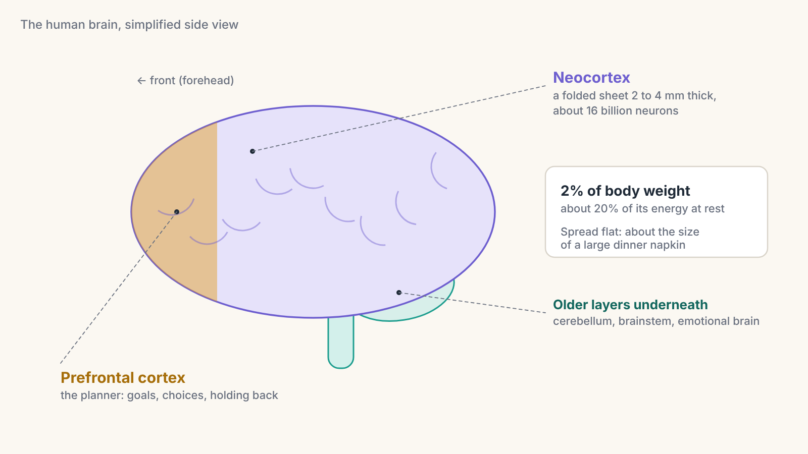
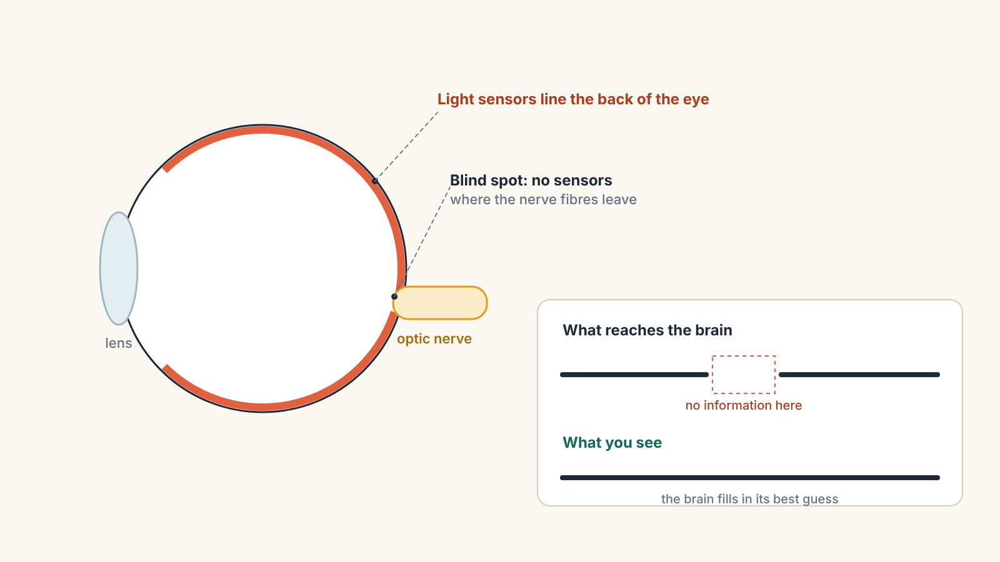
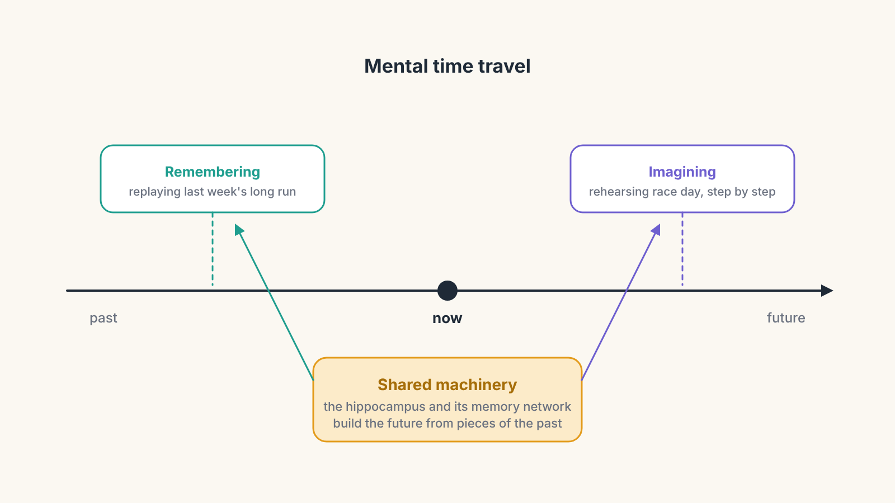
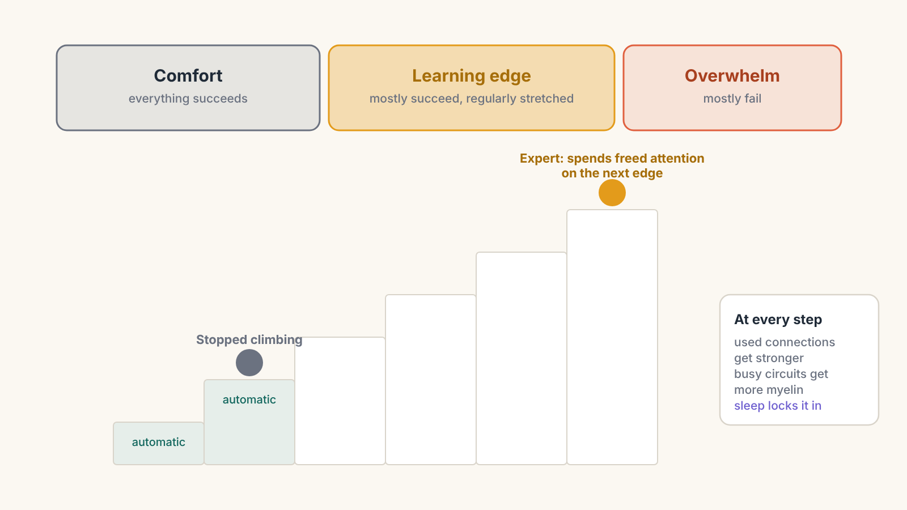
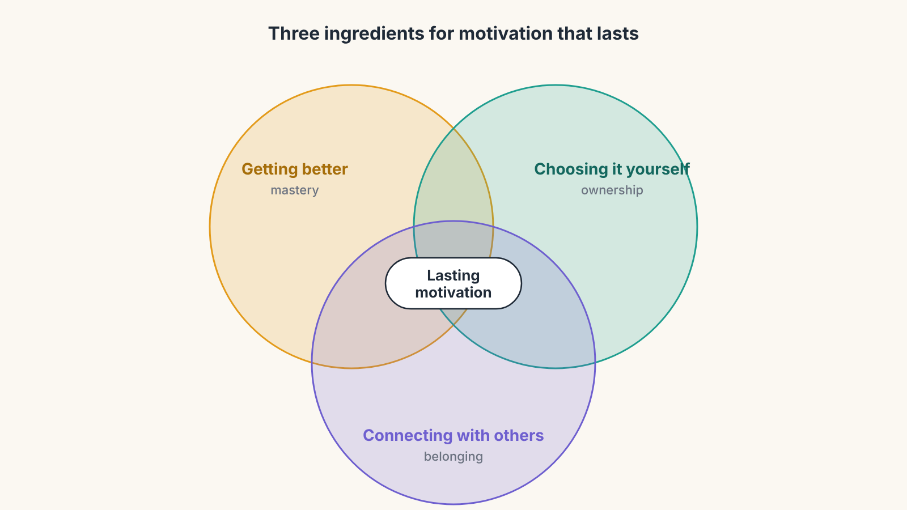
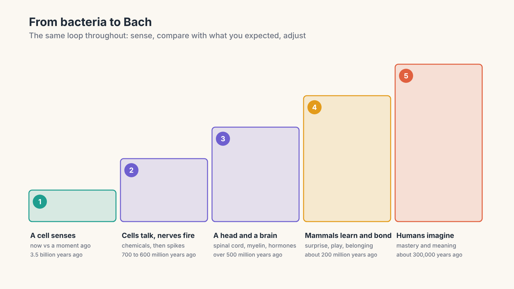

# From Bacteria to Bach, Part 5: The Brain That Imagines Tomorrow

*How humans learned to rehearse the future, and why we chase mastery and meaning*

Over the last four parts, we have followed one thread through 3.5 billion years. A bacterium learned to sense and steer. Cells learned to talk, and nerves made their messages fast. A head appeared, then a spinal cord and a brain, then insulated wires and hormones. Mammals learned to change their own connections, to be surprised, to be curious, to play, and to need each other.

This final part is about the last big step: a brain that does not just react to the world or learn from it, but **imagines** it. A brain that can picture a race it has not run yet, rehearse a conversation in a language it is still learning, and work for years towards something that matters to other people.

We will cover five ideas: the human brain's huge outer layer, the surprising fact that perception is mostly prediction, the ability to travel in time in your mind, how practice turns effort into effortless skill, and why our deepest drives are to get better at things and to matter to others.

---

## The milestone: a thinking layer

Modern humans appeared around 300,000 years ago, in Africa. Our brains are built on the same plan as every other mammal's: brainstem, cerebellum, the deep emotional structures from Part 4. What sets us apart is the outer layer.

The **neocortex** is a thin sheet of neurons, only about two to four millimetres thick, wrapped around the top of the brain. In humans it is so large that it has to be folded and crumpled to fit inside the skull, which is why the brain looks wrinkled. Spread flat, it would cover roughly the area of a large dinner napkin. It contains about 16 billion of the brain's roughly 86 billion neurons.

The front part of it, just behind your forehead, is the **prefrontal cortex**. Think of it as the brain's planner. It holds a goal in mind, weighs options, holds back an impulse, and switches strategy when something is not working. It is also the last part of the brain to finish developing, continuing to mature until around the mid-twenties.

All this comes at a cost. The brain is about 2% of your body weight but uses around 20% of your energy at rest. Evolution only keeps something that expensive if it pays for itself. So what does all that extra cortex buy?

The short answer: **the ability to model the world, and to run that model forwards.**

---

## Your brain is a prediction machine

Here is one of the strangest ideas in modern neuroscience. You do not see the world directly. You see your brain's best guess about the world.

Remember from Part 2 that no light, sound or smell ever enters your brain. All that arrives is the same kind of electrical spike, from every sense. The brain is like someone in a sealed room, piecing together what is happening outside from coded messages passed under the door. To make sense of those messages quickly, it does not wait for all the information. It **predicts**.

A leading theory, called **predictive processing**, says the brain constantly generates guesses about what its senses are about to report. Incoming signals are compared with those guesses, and mostly what travels up the system is the **difference**: the surprise. The model gets updated, and the cycle repeats many times a second. It is the bacterium's "now compared with a moment ago" from Part 1, and dopamine's "better or worse than expected" from Part 4, scaled up to everything you perceive.

You can catch the brain's predictions in action:

- **Your blind spot.** Each eye has a spot with no light sensors, where the nerve fibres leave the eye. You never see a hole in your vision. Your brain fills it in with whatever it predicts should be there. You can find yours in the interactive tool below.
- **The hollow mask.** Look at the inside of a hollow face mask and it appears to bulge outwards like a normal face. Your brain's expectation that faces stick out overrides the actual depth information.
- **The dress.** In 2015, a photo of a dress split the internet: some people saw blue and black, others white and gold. Same photo, different hidden assumptions about the lighting, different colours seen.

The neuroscientist Anil Seth describes perception as a "controlled hallucination." It is a hallucination because the brain generates it from the inside. It is controlled because the senses keep correcting it. Usually the result is close enough to reality to keep you alive. That is what it was built for: being useful, not being a perfect copy. This is why perception is sometimes called **subjective reality**.

> **Key idea:** The brain does not passively receive the world. It predicts it, and uses the senses to check and correct those predictions. What you experience is the brain's model.

---

## Mental time travel

Once you have a model of the world, you can do something extraordinary with it: run it without the world. That is imagination.

You can replay yesterday's argument and think of what you should have said. You can picture tomorrow's race, step by step. You can rehearse a job interview, or a conversation in French, before it happens. Scientists call this **mental time travel**.

Remarkably, remembering and imagining seem to use much of the same machinery. The hippocampus, which we met in Part 4 recording new memories, is also active when people imagine future scenes. People with serious damage to the hippocampus often struggle not only to remember their past but also to imagine a detailed future. It seems the brain builds the future out of pieces of the past.

This ability changes everything about motivation. A bacterium responds to the food in front of it. A dog can wait a little while for a treat. A human can choose to be uncomfortable today, getting up early to train or sitting down to practise verbs, because the planner can hold a picture of a goal months or years away and attach today's effort to it.

Mental rehearsal can even improve skills. Studies of athletes and musicians find that imagining a movement in detail does improve later performance, though less than real practice. It works best as an addition to physical practice, not a replacement.

---

## How practice turns effort into skill

Now we can bring together everything from the series to explain how anyone, at any age, gets genuinely good at something.

**Step one: work at the edge.** In Part 4 we saw that the brain learns most from surprise and error. If a task is too easy, there are no errors to learn from. If it is far too hard, errors are so constant that there is no useful signal, only confusion. The psychologist Anders Ericsson studied how experts train and found that they do not just repeat what they can already do. They practise **deliberately**: just beyond their current ability, with one specific target, and with clear feedback on how they did. One mathematical study of learning suggested that, for some kinds of learning, progress is fastest when you succeed roughly 85% of the time. That number is a guide, not a law, but the shape is right: mostly succeeding, regularly stretched.

**Step two: the right connections get stronger.** Each attempt at the edge strengthens the connections you used, especially when an error is corrected or a success is better than expected. The cerebellum fine-tunes the timing by comparing what you intended with what happened.

**Step three: the wires get insulated.** In Part 3, myelin made big, fast animals possible. It turns out the brain keeps adding myelin through life, especially around circuits that get used a lot. In one experiment, mice learning to run on a tricky wheel with irregularly spaced rungs needed to build new myelin to master it. When that was blocked, they struggled to learn. Practice builds faster, better-timed wiring.

**Step four: the skill becomes automatic.** As you repeat a skill, the brain gradually packages its steps into a single chunk, run more and more by the habit circuits deep in the brain rather than by the planner. A beginner driver thinks "mirror, signal, check, brake, turn." An expert just turns. That handover frees the planner's attention, which is the crucial part. The expert spends that freed attention noticing finer details and pushing at the next edge. Someone who has stopped improving spends it on nothing.

**Step five: sleep locks it in.** Much of the strengthening of new memories and skills happens offline, during sleep, when the brain replays the day's practice.

> **Key idea:** Mastery is the learning loop, pushed deliberately to the edge, again and again. Effort at the edge strengthens and insulates the right circuits; repetition makes them automatic; automation frees attention for the next edge.

### A warning: old habits are never deleted

There is one catch. When you learn a new way of doing something, the old way does not disappear. The brain builds a new pathway beside the old one, and the two compete. The old pathway has years of strengthening and insulation behind it, so it is fast and reliable. The new one is weaker and needs the planner's attention to win.

When you are fresh and focused, the planner holds the new technique in place. But fatigue, stress, speed or an unfamiliar setting weaken the planner, and the old pattern takes over again. That is why a corrected habit can suddenly reappear at the worst moment. The answer is to practise the new way while fresh until it is reliable, then add pressure step by step, so the new pathway learns to win in harder conditions too.

---

## Mastery and meaning

Why do we bother? Why would anyone spend years on a skill that no one is forcing them to learn?

Psychologists Edward Deci and Richard Ryan spent decades studying what keeps people motivated over the long term. Their research suggests three ingredients, sometimes called basic psychological needs:

- **Getting better:** feeling your skill grow. This is the surprise-and-learning machinery of Part 4, aimed at a goal.
- **Choosing it yourself:** doing something because you decided to, not because you were made to.
- **Connecting with others:** feeling that you belong, and that what you do matters to people you care about.

The third ingredient connects straight back to Part 4. In one brain-scanning study, giving money to a good cause activated some of the same reward areas as receiving money yourself. For a social species, contributing to the group is rewarding in itself. Our ancestors survived because the group survived, and a brain that rewards being useful to others was a brain that got kept.

Humans added one more thing no other animal has to the same degree: **culture**. We learn not only from our own experience, but from each other, across generations. A child today can learn in a few years mathematics that took humanity thousands of years to discover. Language, writing, teaching and music let one brain's hard-won mastery become another brain's starting point.

---

## From bacteria to Bach

The title of this series borrows from the philosopher Daniel Dennett, whose book *From Bacteria to Bach and Back* asked how minds like ours could grow out of simple living things. Johann Sebastian Bach, the German composer born in 1685, is a fitting place to end, because his life shows every idea in this series working together.

Bach grew up in a family of musicians and learned by copying the scores of other composers. According to an early account of his life, as a young man he walked roughly 400 kilometres to hear the famous organist Dieterich Buxtehude play, and stayed for months to learn. That is mastery: deliberate practice, at the edge, learning from the best. But Bach also wrote much of his music for others: for his church congregation, his family and his students. His great keyboard collection, *The Well-Tempered Clavier*, carries a title page saying it was written for "the use and profit of musical youth desirous of learning." That is belonging: a lifetime of skill, put to work for other people, and passed on.

And underneath it all is the loop the bacterium started with: sense, compare with what you expected, adjust. Bach was doing it every time he played a phrase, heard it, and tried again.

---

## Try it yourself: Prediction and Practice

<iframe src="prediction-and-practice-simulator.html" title="Prediction and Practice" width="100%" height="980" style="border:0;"></iframe>

*If the tool does not appear above, [open Prediction and Practice in its own page](prediction-and-practice-simulator.html).*

This tool has two parts.

**Find your blind spot.** Close your left eye, look at the cross with your right eye, and slowly move your head closer to or further from the screen. At some distance, the dot disappears. Switch on the striped background and notice that where the dot vanishes, you do not see a hole. Your brain fills in the stripes it predicts should be there.

**Practise at the edge.** Three learners practise the same skill for the same number of attempts. One always picks tasks that are too easy, one always picks tasks that are far too hard, and one keeps adjusting to stay at the edge. Then set your own success rate, switch feedback on and off, and see how your learner compares. The tool uses a simple model of learning, so treat the numbers as an illustration of the shape, not a precise prediction.

---

## In your running

Everything in the series now comes together for a runner.

**You run inside a prediction.** Much of what you feel during a run is your brain's estimate of your effort and what is left in the tank. Some researchers argue that the sensation of exhaustion is partly the brain's protective forecast rather than a direct readout from the muscles, though how much is still debated. Either way, experience changes the forecast. A pace that felt frightening last year can feel calm this year, partly because your brain now predicts you can hold it.

**Mental rehearsal helps.** Picturing your race in detail, the start, the hard middle, the moment you want to slow down, is a genuine form of practice. Use it alongside training, not instead of it.

**Train the skill at the edge, and the engine with patience.** Most endurance training is easy running, which builds the heart, the blood supply and the energy factories in the muscles. Skill is different. Short, focused moments of practice at the edge, with one target and feedback, such as a few fast strides with attention on a quick, light cadence, are what improve technique.

**Expect old habits under fatigue.** A form change practised in fresh training runs can fall apart late in a long race, when fatigue weakens the planner and the old, well-insulated pattern returns. That does not mean the change failed. It means the new pathway needs gradual practice in tired conditions too.

**Running with meaning lasts longer.** Training for something you chose, alongside people who care, with a goal that matters beyond the clock, ticks all three boxes of lasting motivation.

---

## In learning French

**Listening is predicting.** A native French speaker understands fast speech partly because their brain predicts the next sound and word before it arrives. A beginner's brain cannot predict yet, so it has to process every sound from scratch, and fast speech overwhelms it. As your French model grows, predictions improve, and the same speed starts to feel slower. That is why listening to lots of French you mostly understand matters so much.

**Rehearse conversations in your head.** Before ordering in a café, imagine the exchange: what you will say, what they might reply, what you will say next. Mental rehearsal builds on the same machinery as memory and makes the real moment less overwhelming.

**Grammar becomes automatic.** At first you build each sentence consciously: "*table* is feminine, so *la*, so the adjective changes." With enough practice and exposure, the habit circuits take over and *la belle table* simply sounds right. That frees your attention for meaning, jokes and the person in front of you. That is fluency.

**English will interrupt under pressure.** When you are tired, nervous or speaking fast, English words and word order slip in. That is the old pathway winning. Practise speaking while fresh, then gradually add real conversations at real speed.

**Learn French for someone.** The strongest reason to keep going is connection: talking with people, understanding a culture, sharing something you love. Choose what you study, get better week by week, and use it with people. All three ingredients, together.

---

## The whole journey

Here is the series in one breath. A single cell learned to sense its world and steer by comparing now with a moment ago. Cells joined together and learned to talk, first with drifting chemicals, then with fast electrical nerves. Moving forward gave animals a head, a spinal cord and a brain, with insulated wires and hormones to run the body. Mammals learned to rewrite their own connections, guided by surprise, curiosity and play, and to need each other. And humans learned to imagine the future, to practise towards it on purpose, and to share what they learn.

---

## Key ideas from Part 5

- The human **neocortex** is a thin, folded sheet of about 16 billion neurons. The **prefrontal cortex** at the front is the planner.
- The brain is a **prediction machine**. Perception is its best guess, constantly checked and corrected by the senses.
- Remembering and imagining share machinery, giving us **mental time travel**: rehearsing the future and working towards distant goals.
- **Mastery** comes from deliberate practice at the edge, with a clear target and feedback. Used circuits are strengthened and insulated, skills become automatic, and freed attention moves to the next edge. Sleep helps lock it in.
- **Old habits are never deleted.** They compete with new ones and can return under fatigue or stress.
- Lasting motivation tends to come from **getting better, choosing it yourself, and connecting with others**.
- **Culture** lets one person's mastery become another's starting point, from bacteria all the way to Bach.

---

## Thank you for reading

This series began with a single bacterium in a drop of water, steering towards sugar by asking one question: is it better now than a moment ago? Three and a half billion years later, you are still asking that question, every time you practise something hard, notice that it is getting easier, and decide to keep going. The difference is that you can choose where you are going, and who you are going there with.
